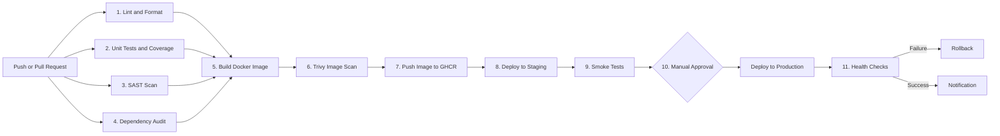

# Production CI/CD Pipeline with Security Gates

## Project Overview

This project demonstrates how to automate the process of testing, securing, building, and deploying a Node.js application to Kubernetes using GitHub Actions.

Instead of manually checking the code and deploying every new version, the pipeline handles most of the work automatically. It runs code quality checks, unit tests, security scans, and a Docker image build before deploying the application to staging.

If the staging checks pass, the production deployment can proceed after manual approval. The production deployment uses a blue-green strategy, with health checks and an automatic rollback if the new version fails.

## Pipeline Diagram

The diagram below shows the main stages of the pipeline, from a code push to production deployment.



Pull requests run the code checks, tests, security scans, and image build and scan. The image is not pushed to the registry during this stage. The remaining deployment stages run on a push to the `main` branch, subject to the workflow conditions and successful completion of the required jobs.

## Pipeline Stages

The pipeline is divided into jobs so that each part has a clear responsibility.

| Stage                                           | Job                 | Tool or service                  |
| ----------------------------------------------- | ------------------- | -------------------------------- |
| 1. Lint and format                              | `lint`              | ESLint and Prettier              |
| 2. Unit tests and coverage                      | `test`              | Jest                             |
| 3. Static application security testing          | `sast`              | Semgrep                          |
| 4. Dependency vulnerability audit               | `audit`             | npm audit                        |
| 5. Build Docker image                           | `image`             | Docker Buildx                    |
| 6. Scan the image                               | `image`             | Trivy                            |
| 7. Push the image                               | `image`             | GitHub Container Registry (GHCR) |
| 8. Deploy to staging                            | `deploy-staging`    | kubectl                          |
| 9. Test staging                                 | `smoke-test`        | `scripts/smoke-test.sh`          |
| 10. Approve and deploy to production            | `deploy-production` | GitHub Environments              |
| 11. Check production and roll back if necessary | `deploy-production` | `scripts/deploy.sh`              |

The lint, test, SAST, and dependency audit jobs run independently. The image job depends on these checks, so a failure in a required job prevents the pipeline from moving forward.

After the image has been built and scanned, it is pushed to GHCR with a tag based on the Git commit SHA. This makes it possible to identify the exact version of the code used for a deployment.

## Security Gates

The pipeline includes checks designed to prevent code that fails the required quality or security rules from progressing to deployment.

| Check                | What causes it to fail                                               | Implementation                                  |
| -------------------- | -------------------------------------------------------------------- | ----------------------------------------------- |
| Lint and formatting  | ESLint reports errors or files fail the formatting check             | `npm run lint` and `npm run format:check`       |
| Unit tests           | One or more tests fail                                               | Jest                                            |
| Test coverage        | Coverage falls below 70% for the configured metrics                  | Jest `coverageThreshold` in `package.json`      |
| SAST                 | Semgrep reports findings at the configured severity                  | `semgrep scan --severity ERROR --error`         |
| Dependency audit     | A high or critical vulnerability is found in a production dependency | `npm audit --omit=dev --audit-level=high`       |
| Container image scan | Trivy finds a critical vulnerability in the image                    | `trivy image --exit-code 1 --severity CRITICAL` |

These checks are intended to stop the pipeline when their configured rules are violated. The exact severity thresholds depend on the command used by each tool.

Other security measures included in the project are:

- **Non-root execution:** The Docker container runs as the `node` user, and the Kubernetes configuration requests non-root execution.
- **Multi-stage Docker build:** The final image is designed to contain the application and its production dependencies rather than the complete build environment.
- **Secret management:** Kubernetes access is configured through the `KUBECONFIG` GitHub Actions secret. The workflow uses `GITHUB_TOKEN` for registry authentication.
- **Restricted permissions:** The workflow has read-only repository content permissions by default, while the image job receives permission to publish packages.
- **Production approval:** A reviewer must approve the production deployment through the configured GitHub Environment protection rules.

**Note:** The workflow currently uses `aquasec/trivy:latest`. For a more reproducible production setup, this should be pinned to a specific, verified version or image digest.

## Project Structure

The main files and their purposes are listed below.

```text
src/
  app.js                  Application routes and logic
  server.js               Starts the application server

tests/                    Unit tests

Dockerfile                Multi-stage Docker image build
package.json              Dependencies, scripts and test settings

k8s/
  staging/                Staging namespace and Kubernetes resources
  production/             Production namespace, service and blue-green deployments

scripts/
  deploy.sh               Production deployment, health checks and rollback
  smoke-test.sh           Tests the staging application
  notify.sh               Prints notifications and optionally posts to Slack

.github/
  workflows/              GitHub Actions pipeline configuration
  actions/                Reusable Kubernetes setup action

README.md                 Project documentation
```

## Setting Up the Project

### 1. Create a GitHub repository

Create a repository on GitHub and push the project to the `main` branch. Make sure the workflow and application files are included in the repository.

### 2. Configure Kubernetes access

The pipeline needs access to a Kubernetes cluster that its GitHub Actions runner can reach.

In your repository, open **Settings → Secrets and variables → Actions → New repository secret**.

Create a secret named `KUBECONFIG` and provide the kubeconfig content required by the deployment workflow. The credentials should have only the permissions needed for the deployment.

The cluster endpoint must be reachable from the runner. Do not commit kubeconfig files or credentials to the repository.

### 3. Configure GitHub Environments

Open **Settings → Environments** and create two environments:

- `staging`
- `production`

Configure the production environment to require approval from a reviewer. Add an authorized reviewer so the production job pauses until approval is granted.

### 4. Configure Slack notifications (optional)

To send notifications to Slack, create a repository secret named `SLACK_WEBHOOK_URL` containing the webhook URL.

If the webhook is not configured, the notification script prints its message to the job log instead.

### 5. Allow Kubernetes to pull the image

The Kubernetes cluster must be able to download the application image from GHCR.

One option is to make the package public. Alternatively, keep it private and configure an appropriate Kubernetes `imagePullSecret` with the required registry permissions.

For production use, prefer private images and appropriately scoped credentials.

### 6. Run the pipeline

Push a change to `main` and open the **Actions** tab in GitHub to follow the workflow.

If the checks pass and the staging smoke tests succeed, the workflow should reach the production approval stage. Approve the deployment when it is ready to proceed.

A successful workflow run should show the code checks, image scan, staging deployment, smoke tests, production approval, and production health checks completing as expected.

## Production Deployment: Blue-Green Strategy

The production environment uses two Kubernetes Deployments: `app-blue` and `app-green`.

A Kubernetes Service named `webapp` routes traffic to the active version using a `version` selector.

The deployment script, `scripts/deploy.sh`, follows these steps:

1. **Identify the active version.** It reads the Service selector to determine whether blue or green is currently receiving traffic.
2. **Deploy the new version.** It updates the inactive Deployment with the new image.
3. **Wait for readiness.** It waits for the new Pods to become ready, with a timeout of up to five minutes. The Service continues routing traffic to the old version during this step.
4. **Switch traffic.** Once the new version is ready, the script updates the Service selector to point to it.
5. **Monitor application health.** The script checks the `/health` endpoint every ten seconds for five minutes.
6. **Roll back on failure.** If a health check fails, the script switches the Service back to the previous version and exits with an error so the deployment job is marked as failed.

The previous Deployment remains available after a successful switch, allowing traffic to be redirected back quickly if a problem is detected.

For testing, the health-check window can be shortened by setting `HEALTH_WINDOW=60` in the deployment step, provided the script uses that variable as expected.

## Notifications

The `scripts/notify.sh` script reports the deployment result.

It prints a message to the GitHub Actions job log and can also send a Slack notification when `SLACK_WEBHOOK_URL` is configured.

This provides a basic way to see whether the deployment succeeded or failed without having to inspect every step manually.

## Running the Application Locally

You can run the basic checks locally before pushing changes to GitHub.

```bash
npm install
npm run lint
npm run format:check
npm test
npm start
```

After starting the application, visit:

- Application health: `http://localhost:3000/health`

These commands assume that Node.js and npm are installed and that the scripts are defined in `package.json`.

## Conclusion

This project brings together automated testing, security checks, Docker image building, and Kubernetes deployment in one workflow. It also demonstrates how a staging environment, production approval, blue-green deployment, health monitoring, and rollback can help reduce the risk of releasing a faulty application.

The main goal is to make deployments more consistent and easier to verify, while ensuring that failures in the required checks prevent the application from progressing to the next stage.
